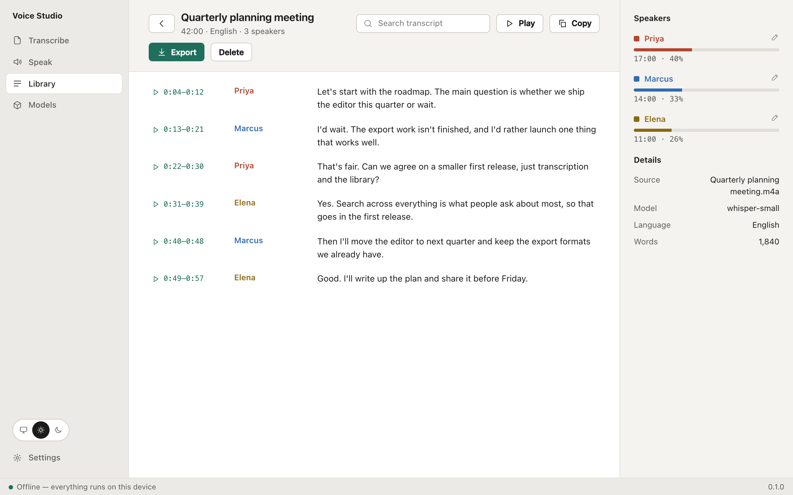
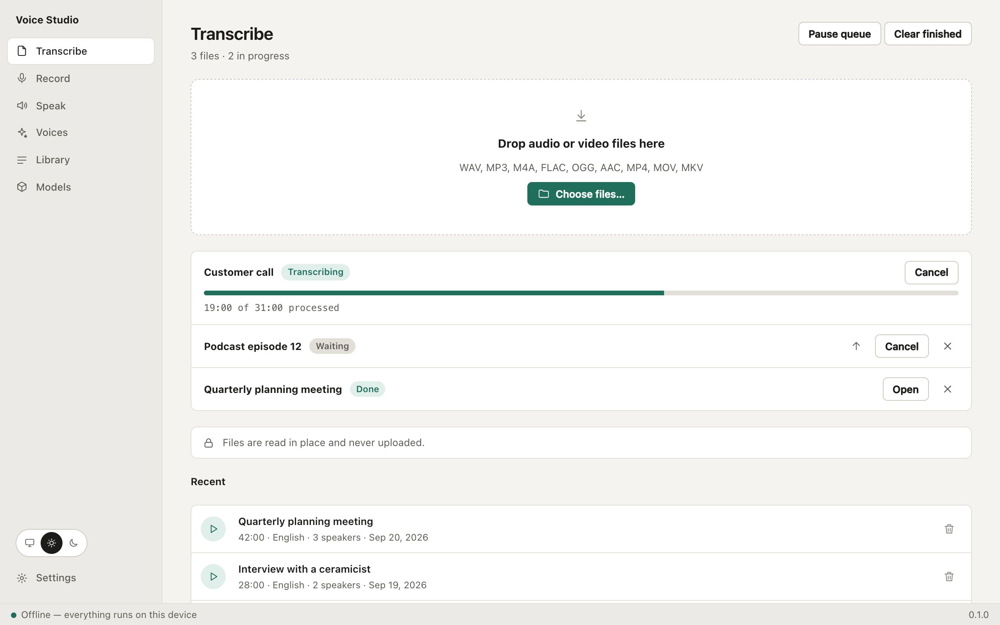
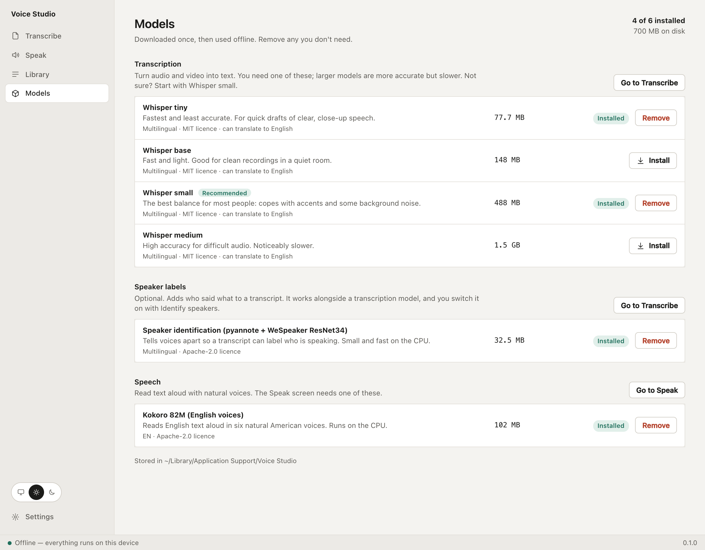
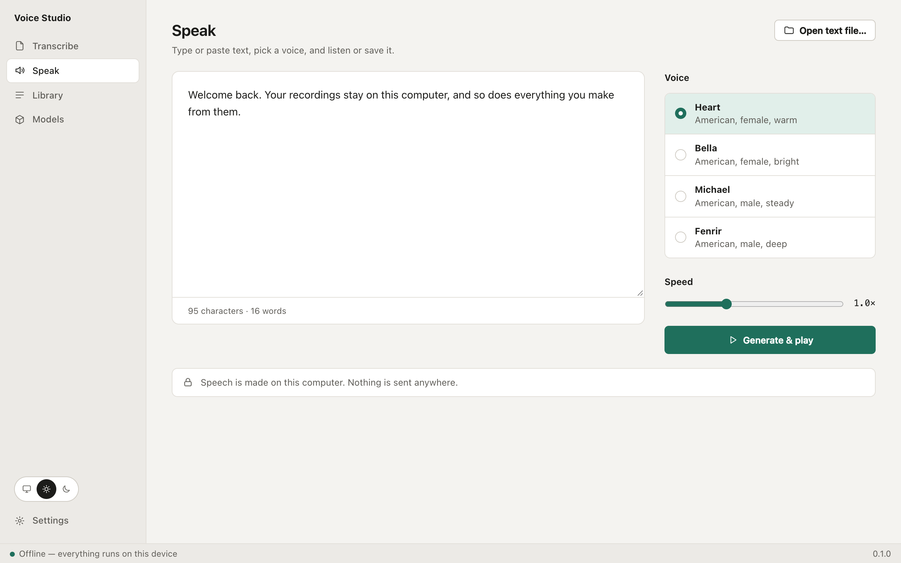

# Voice Studio

**Turn speech into text, and text into speech, without sending anything anywhere.**

Voice Studio is a desktop app and a command-line tool that transcribes recordings, labels who said what,
and reads text aloud, all on your own computer. No account, no cloud, no per-minute fees. Models download
once; after that it works offline.

Windows, macOS and Linux. Open source (MIT).

> **Status: early development, not released yet.** Transcription, speaker labels and text to speech work.
> Recording, live captions, dictation and installers are still to come (see the [roadmap](docs/product/roadmap.md)).
> "Voice Studio" is a working name.

<picture>
  <source media="(prefers-color-scheme: dark)" srcset="docs/screenshots/transcript-dark.png">
  
</picture>

_Screenshots show the real interface with made-up sample data._

## What you can do

- **Transcribe audio and video.** Drop in WAV, MP3, M4A, FLAC, OGG, MP4, MOV or MKV files. A queue works
  through them one at a time, skipping silence, with progress you can pause, reorder or cancel.
- **Know who said what.** Turn on _Identify speakers_ to label each line, see who talked how much, and
  rename or merge speakers afterwards.
- **Search everything you have transcribed.** Every transcript goes into a library with full-text search.
  Click a timestamp to hear that moment.
- **Export anywhere.** TXT, SRT and VTT subtitles, Markdown and JSON, with control over line width,
  timestamps and speaker names.
- **Read text aloud.** Paste text or open a file, pick one of six natural English voices, and play or save it.
- **Choose your models.** A model manager shows what each model is for, how big it is, and its licence.
- **Light, dark or system theme.**

## Private by design

Audio and text never leave your computer. The only network use is downloading models, which you start
yourself, and each download is checked against a published checksum. The app has no telemetry.

## Screens

<table>
  <tr>
    <td width="50%">
      <picture>
        <source media="(prefers-color-scheme: dark)" srcset="docs/screenshots/transcribe-dark.png">
        
      </picture>
      <br><sub><b>Transcribe:</b> a queue for many files.</sub>
    </td>
    <td width="50%">
      <picture>
        <source media="(prefers-color-scheme: dark)" srcset="docs/screenshots/models-dark.png">
        
      </picture>
      <br><sub><b>Models:</b> grouped by what they are for.</sub>
    </td>
  </tr>
  <tr>
    <td width="50%">
      <picture>
        <source media="(prefers-color-scheme: dark)" srcset="docs/screenshots/speak-dark.png">
        
      </picture>
      <br><sub><b>Speak:</b> text to speech with six voices.</sub>
    </td>
    <td width="50%">
      <picture>
        <source media="(prefers-color-scheme: dark)" srcset="docs/screenshots/transcript-light.png">
        
      </picture>
      <br><sub><b>Transcript:</b> speakers, timestamps, playback and export.</sub>
    </td>
  </tr>
</table>

## Command line

The same engine as the app, for scripts and servers.

```bash
vtt models pull whisper-small                  # download a model (resumable, checksum-verified)
vtt transcribe talk.m4a                        # print the text
vtt transcribe talk.m4a -f srt -o talk.srt     # subtitles; also txt, vtt, md, json
vtt transcribe meeting.mp4 --diarize           # label the speakers
vtt speak "Hello from my own computer" -o hello.wav
vtt library search "roadmap"                   # search everything you have transcribed
vtt --json transcribe talk.m4a                 # machine-readable events for scripts
```

Run `vtt --help` or see the [CLI reference](docs/product/cli.md) for every command, option and exit code.
Whisper uses the GPU on macOS (Metal) automatically; on Windows and Linux it uses the CPU unless you build
with the optional Vulkan or CUDA feature (see below).

## Get it

There are no installers yet. Until the first release, build from source.

```bash
make setup     # Rust and CMake if missing, JS dependencies, git hooks, first UI build
make dev       # run the desktop app with hot reload
make check     # everything CI runs
```

You need [Rust](https://rustup.rs), a C++ compiler and [CMake](https://cmake.org) (whisper.cpp is built
from source), Node.js 22+, [pnpm](https://pnpm.io) and `make`. On Linux, also the
[Tauri system packages](https://tauri.app/start/prerequisites/). On Windows use Git Bash or WSL.
`make` lists every target.

GPU on Windows and Linux: `cargo build --release -p vtt-cli --features vulkan` (needs the Vulkan SDK) or
`--features cuda` (needs the CUDA toolkit). The desktop crate forwards the same features.

## Under the hood

A Rust core (`vtt-core`) does the work: whisper.cpp for transcription, a WeSpeaker model for speaker
labels, Kokoro for speech, SQLite for the library. The desktop app is a [Tauri 2](https://tauri.app)
shell with a Svelte interface calling the core in-process, so there is no server and no sidecar. The CLI
is a thin front end on the same core. See [architecture](docs/architecture.md).

## Documentation

[Features](docs/product/features.md) · [CLI](docs/product/cli.md) · [Roadmap](docs/product/roadmap.md) ·
[Architecture](docs/architecture.md) · [Design](docs/design/README.md) · [Releasing](docs/releasing.md) ·
[Index](docs/README.md)

## Contributing

See [CONTRIBUTING.md](CONTRIBUTING.md) and the [code guidelines](docs/guidelines.md). Please read the
[Code of Conduct](CODE_OF_CONDUCT.md) and the [Security Policy](SECURITY.md). The earlier Python
prototype is preserved at the git tag `python-final`.

## Licence

[MIT](LICENSE)
