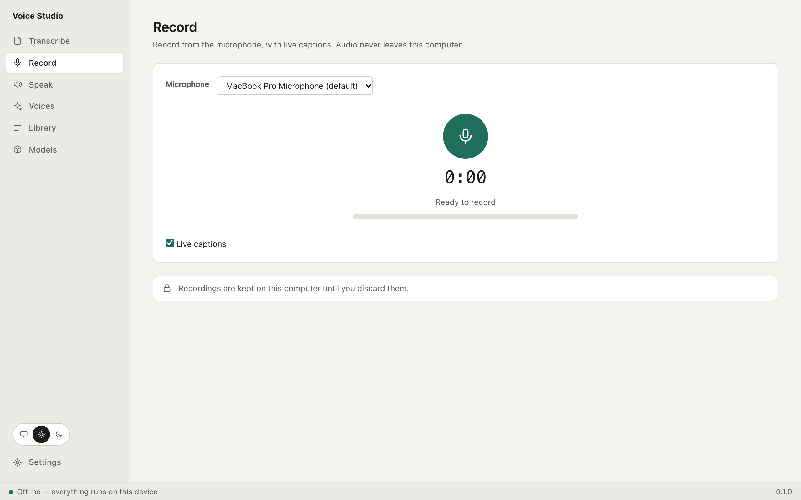
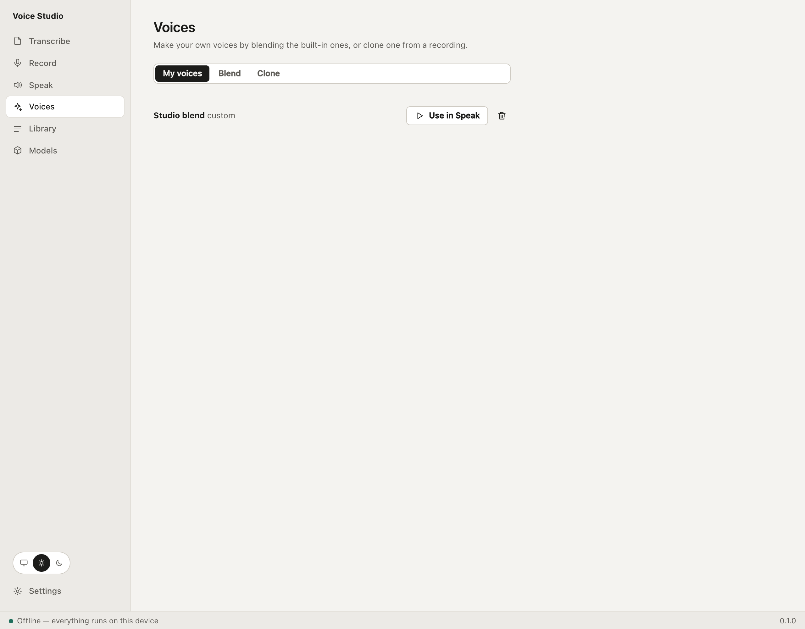
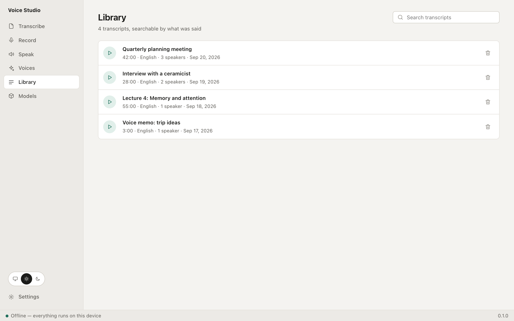

<div align="center">

# Voice Studio

**Turn speech into text, and text into speech, without sending anything anywhere.**

An offline desktop app and command-line tool for Windows, macOS and Linux.
No account, no cloud, no per-minute fees.

[](https://github.com/shahadathhs/voice-studio/actions/workflows/ci.yml)
[](LICENSE)

[](CONTRIBUTING.md)

[Build from source](#installation) ·
[Documentation](docs/README.md) · [CLI reference](docs/product/cli.md) ·
[Roadmap](docs/product/roadmap.md) · [Report a bug](https://github.com/shahadathhs/voice-studio/issues/new/choose)

</div>

<picture>
  <source media="(prefers-color-scheme: dark)" srcset="docs/screenshots/transcript-dark.png">
  
</picture>

_Screenshots show the real interface with made-up sample data._

> [!NOTE]
> **Early development.** Build it from source: there are no prebuilt installers yet. Speech and translation
> quality in some languages has not been reviewed by a native speaker. "Voice Studio" is a working name.
> See the [roadmap](docs/product/roadmap.md).

## Table of contents

- [About](#about)
- [Features](#features)
- [Private by design](#private-by-design)
- [Screens](#screens)
- [Installation](#installation)
- [Usage](#usage)
- [How it works](#how-it-works)
- [Roadmap](#roadmap)
- [Documentation](#documentation)
- [Contributing](#contributing)
- [Security](#security)
- [Acknowledgements](#acknowledgements)
- [License](#license)

## About

Voice Studio is a desktop app and a command-line tool (`vtt`) for working with speech on your own computer. It
transcribes recordings and says who spoke, records from the microphone with live captions, reads text aloud in
seven languages, makes custom voices, and summarises or translates what you transcribed. Models download once;
after that it works offline. The app and the CLI share one engine, so what you script is what you click.

## Features

- **Transcribe audio and video.** Drop in WAV, MP3, M4A, FLAC, OGG, AAC, MP4, MOV or MKV files. A queue works
  through them one at a time, skipping silence, with progress you can pause, reorder or cancel. It is saved, so
  unfinished files resume after a quit or a crash. Seven Whisper models, from tiny to large.
- **Know who said what.** Turn on _Identify speakers_ to label each line, see who talked how much, and rename or
  merge speakers afterwards. Fix a line by editing it or moving it to another speaker.
- **Record with live captions.** Record from any microphone; a rough draft of the words appears as you speak,
  and the full-accuracy pass runs when you stop.
- **Dictate anywhere.** A global shortcut starts and stops dictation; the words are copied to the clipboard,
  ready to paste.
- **Search everything you have transcribed.** Every transcript goes into a library with full-text search. Click
  a timestamp, or the waveform, to hear that moment.
- **Summaries, chapters, action items and translation.** A small language model runs on your computer. Chapters
  jump the player to the right moment. Output is labelled as written by a model, and Bengali is flagged as unreliable.
- **Read text aloud.** 35 built-in voices in English (American and British), Spanish, French, Italian, Brazilian
  Portuguese, Hindi and Mandarin Chinese. Translate first and speak in another language, then save WAV or FLAC.
- **Make your own voices.** Blend built-in voices into a named preset, or clone a voice from a 3 to 30 second
  sample. Cloning needs your confirmation that you own the voice or have permission, and saved audio carries a
  "synthetic voice" note.
- **Export anywhere.** TXT, SRT and VTT subtitles, Markdown, JSON and Word documents, with control over line
  width, timestamps and speaker names.
- **Choose your models.** A model manager shows what each model is for, how big it is, and its licence.
- **Light, dark or system theme**, in English or Spanish.

## Private by design

Audio and text never leave your computer. The only network use is downloading models, which you start
yourself, and each download is checked against a published checksum. The app has no telemetry.

## Screens

<table>
  <tr>
    <td width="50%">
      <picture>
        <source media="(prefers-color-scheme: dark)" srcset="docs/screenshots/transcribe-dark.png">
        
      </picture>
      <br><sub><b>Transcribe:</b> a queue for many files.</sub>
    </td>
    <td width="50%">
      <picture>
        <source media="(prefers-color-scheme: dark)" srcset="docs/screenshots/record-dark.png">
        
      </picture>
      <br><sub><b>Record:</b> microphone input with live captions.</sub>
    </td>
  </tr>
  <tr>
    <td width="50%">
      <picture>
        <source media="(prefers-color-scheme: dark)" srcset="docs/screenshots/speak-dark.png">
        
      </picture>
      <br><sub><b>Speak:</b> text to speech in seven languages.</sub>
    </td>
    <td width="50%">
      <picture>
        <source media="(prefers-color-scheme: dark)" srcset="docs/screenshots/voices-dark.png">
        
      </picture>
      <br><sub><b>Voices:</b> blend or clone your own.</sub>
    </td>
  </tr>
  <tr>
    <td width="50%">
      <picture>
        <source media="(prefers-color-scheme: dark)" srcset="docs/screenshots/library-dark.png">
        
      </picture>
      <br><sub><b>Library:</b> everything you have made, searchable.</sub>
    </td>
    <td width="50%">
      <picture>
        <source media="(prefers-color-scheme: dark)" srcset="docs/screenshots/models-dark.png">
        
      </picture>
      <br><sub><b>Models:</b> grouped by what they are for.</sub>
    </td>
  </tr>
</table>

## Installation

Voice Studio is built from source. There are no downloads: prebuilt installers need code signing, which this
project does not have yet, and unsigned downloads are blocked or warned about by macOS and Windows. A copy you
build yourself starts normally. Full steps are in [docs/building.md](docs/building.md).

```bash
git clone https://github.com/shahadathhs/voice-studio.git
cd voice-studio
make setup     # Rust and CMake if missing, JS dependencies, git hooks, first UI build
make dev       # run the desktop app with hot reload
make build     # the CLI and the desktop app (release mode)
make check     # everything CI runs
```

The app lands in `target/release/bundle/` (copy `Voice Studio.app` to `/Applications` on macOS, or run the
installer you built on Windows and Linux) and the CLI in `target/release/vtt`.

You need [Rust](https://rustup.rs), a C++ compiler and [CMake](https://cmake.org) (whisper.cpp is built
from source), Node.js 22+, [pnpm](https://pnpm.io) and `make`. On Linux, also the
[Tauri system packages](https://tauri.app/start/prerequisites/) and the ALSA headers (`libasound2-dev`) for
microphone recording. On Windows use Git Bash or WSL. `make` lists every target.

GPU on Windows and Linux: `cargo build --release -p vtt-cli --features vulkan` (needs the Vulkan SDK) or
`--features cuda` (needs the CUDA toolkit). The desktop crate forwards the same features.

## Usage

### Command line

The same engine as the app, for scripts and servers.

```bash
vtt models pull whisper-small                  # download a model (resumable, checksum-verified)
vtt transcribe talk.m4a                        # print the text
vtt transcribe talk.m4a -f srt -o talk.srt     # subtitles; also txt, vtt, md, json
vtt transcribe meeting.mp4 --diarize           # label the speakers
vtt record -o note.wav --live --transcribe     # record with live captions, then transcribe
vtt speak "Hello from my own computer" -o hello.wav
vtt speak "Hello" --translate-to es -o hola.wav  # translate, then speak in Spanish
vtt voice create Warm --blend af_heart:0.6,af_bella:0.4   # a custom voice
vtt summarize 12 --chapters --actions          # summary, chapters and tasks for a library item
vtt translate 12 --to zh -f srt -o talk.zh.srt
vtt library search "roadmap"                   # search everything you have transcribed
vtt --json transcribe talk.m4a                 # machine-readable events for scripts
```

Run `vtt --help` or see the [CLI reference](docs/product/cli.md) for every command, option and exit code.
Whisper uses the GPU on macOS (Metal) automatically; on Windows and Linux it uses the CPU unless you build
with the optional Vulkan or CUDA feature (see [Installation](#installation)).

## How it works

A Rust core (`vtt-core`) does the work: whisper.cpp for transcription, pyannote and WeSpeaker models for speaker
labels, Kokoro for speech, Chatterbox for voice cloning, Qwen 2.5 on [candle](https://github.com/huggingface/candle)
for summaries and translation, and SQLite for the library. The desktop app is a [Tauri 2](https://tauri.app)
shell with a Svelte interface calling the core in-process, so there is no server and no sidecar. The CLI is a thin
front end on the same core. See [architecture](docs/architecture.md).

## Roadmap

Next: code signing and prebuilt installers, and an updater. Open questions: speech in Japanese and
Bengali (a Bengali voice with a permissive licence is a research gate), and a native speaker's review of the
translation and speech quality in each language. Not planned: MP3 output and playing audio from the CLI. See the
[roadmap](docs/product/roadmap.md) for status.

## Documentation

[Features](docs/product/features.md) · [CLI](docs/product/cli.md) · [Roadmap](docs/product/roadmap.md) ·
[Architecture](docs/architecture.md) · [Design](docs/design/README.md) · [Website](docs/site.md) ·
[Building](docs/building.md) · [Index](docs/README.md)

## Contributing

Contributions are welcome. Read [CONTRIBUTING.md](CONTRIBUTING.md) and the [code guidelines](docs/guidelines.md)
first; work happens on the `dev` branch and commits follow
[Conventional Commits](https://www.conventionalcommits.org). Please follow the [Code of Conduct](CODE_OF_CONDUCT.md).

## Security

Report vulnerabilities privately; see the [Security Policy](SECURITY.md).

## Acknowledgements

Voice Studio stands on [whisper.cpp](https://github.com/ggml-org/whisper.cpp) (transcription),
[Qwen 2.5](https://github.com/QwenLM/Qwen2.5) (summaries and translation), [Chatterbox](https://github.com/resemble-ai/chatterbox) (voice cloning),
[pyannote](https://github.com/pyannote/pyannote-audio) and [WeSpeaker](https://github.com/wenet-e2e/wespeaker)
(speaker labels), [Kokoro](https://github.com/hexgrad/kokoro) (speech), [Tauri](https://tauri.app) and
[Svelte](https://svelte.dev). Each model's licence is listed in the app and in
[THIRD_PARTY_NOTICES.md](THIRD_PARTY_NOTICES.md).

## License

[MIT](LICENSE)
